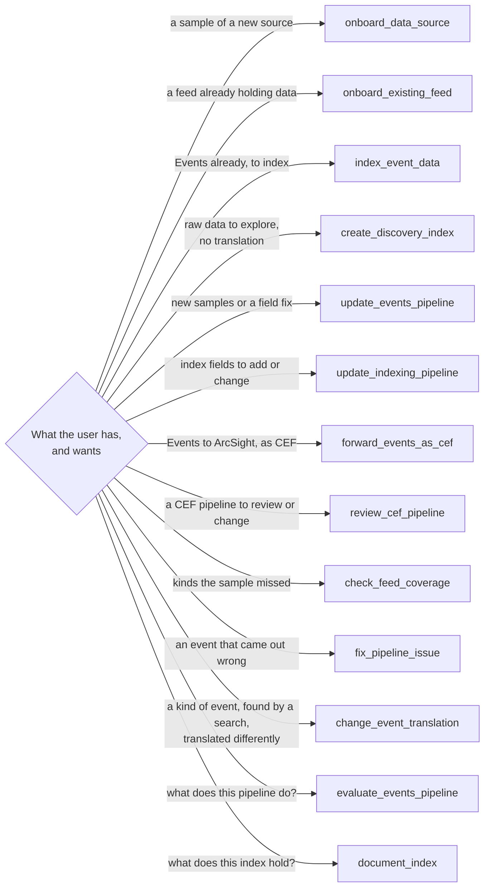

# Workflows

Each workflow is an MCP prompt, which VS Code offers as a slash command (`/mcp.stroom.<prompt>`). A user can also
just ask in their own words, and the agent picks the workflow. They share the same steps and rules: work happens in
a build, is checked, and is promoted only on approval.

| Workflow | Starts from | Ends with |
| --- | --- | --- |
| `onboard_data_source` | Sample files of a new source | Feed, events pipeline, indexing pipeline and documentation, promoted |
| `onboard_existing_feed` | A Raw Events feed that already holds data | An events pipeline for its kinds of event, stepped on the feed's own records where they are, promoted. Processing the feed is yours to start |
| `index_event_data` | An Events feed | An indexing pipeline and index, verified and promoted |
| `create_discovery_index` | Raw JSON, CSV or XML, a sample or a feed | The records indexed as they are, to explore before a translation is written |
| `update_events_pipeline` | An events pipeline, with new samples or a field fix | A new version, or a change in place on a working copy. The new output is compared with the current one record by record |
| `update_indexing_pipeline` | An indexing pipeline, with fields to add or change | The next version beside the current one, starting on new Events. The current one keeps running |
| `fix_pipeline_issue` | The Events stream id and event id of an event that came out wrong (a dashboard row has both), or a description the agent searches the index for | The event traced back to its record, a fix proven on it and the other events of its kind the index holds, applied with a backup, and what it reaches: the raw streams to reprocess and, for Elasticsearch, the delete to run first |
| `change_event_translation` | An index, the events as you would search for them, and the change you want | The kind of event they are translated differently: the events found and confirmed with you, the change generalised to a rule (said to you with how many events it reaches before anything changes), proven on them, promoted, and the raw streams to reprocess and the Elasticsearch delete, for you |
| `evaluate_events_pipeline` | Any events pipeline, including ones the server didn't build | A report (errors and schema compliance first, then its mapping and events) and a Documentation doc. Read only, unless a fix is approved |
| `document_index` | An Elastic Index or Lucene Index doc | A Documentation doc of what the index holds, surveyed through Stroom |
| `check_feed_coverage` | An events pipeline that has processed its feed | Kinds of event the sample missed, found across the feed, and covered |
| `forward_events_as_cef` | An Events feed and a Kafka topic | A pipeline sending the Events to ArcSight as CEF |
| `review_cef_pipeline` | A CEF output pipeline | A review against the CEF dictionary, or a change |

## Questions about the data

People who search the data, rather than build pipelines, can ask what a feed holds and what a field means. The
answer covers where a field comes from and how to search it. It uses only `describe_feed`, which reads and acts as
the signed-in user. The answer comes from the documentation the server generated and the indexes' own field types.
See [Clients](../admin/clients.md).
